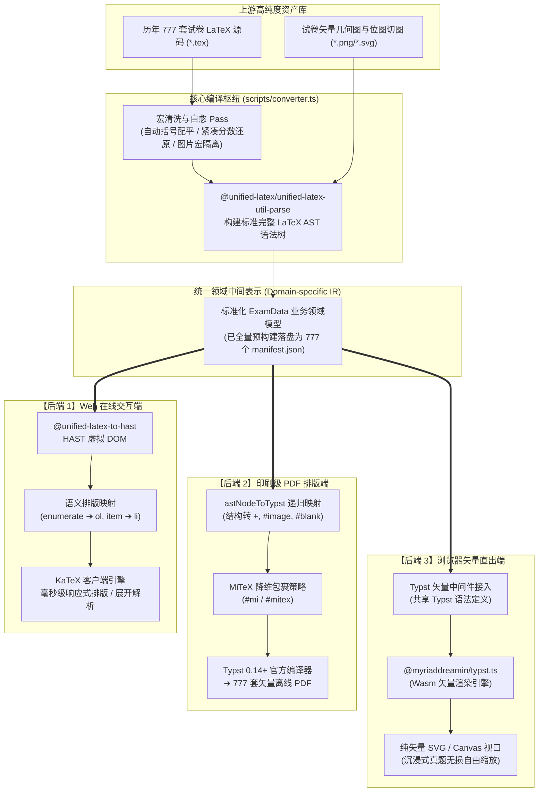
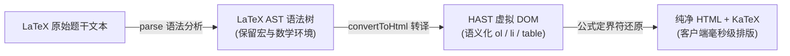

# 🛠️ 架构设计与转换原理

本项目旨在将新中国建国以来（**1952 ～ 2026 年，64 个年份、777 套试卷、16,321 道真题**）的全部真实高考数学试卷数字化，融合 **Typst 现代出版排版** 与 **VitePress Web 沉浸式交互题库**。

本文深度剖析支撑整套系统高效运转的底层编译流水线架构，从**香农信息论的第一性原理**与**现代工业级编译器（LLVM）的架构对标**出发，解密如何将历史跨度极长、排版宏繁杂的 LaTeX 语料，高保真地分流转译为网页交互题卡与无损矢量印刷级 PDF。

---

## 一、 问题的本质：为什么输入必须是 LaTeX 源码？（信息论视角）

很多人在初次接触试卷数字化项目时，常会产生一个朴素的疑问：*“既然网络上有历年高考试卷的 PDF，为什么不能直接写个程序或用 AI 把 PDF 转成网页和代码？”*

答案隐藏在计算机科学与现代信息论的最底层法则中：**PDF 是“信息的终点墓地（Digital Paper）”，高维语义向低维物理平面的投影是不可逆的。**

```
LaTeX 语义空间 X ────────[ 有损物理投影 f ]────────> PDF 几何坐标空间 Y
      │                                                       │
      │                                                       ▼  [ 逆向估计 g ]
      └─────────────────[ 语义丢失: 互信息坍缩 ]─────────> 猜出的代码 X̂
```

### 1. 定性分析：多对一映射与条件熵膨胀（$H(X \mid Y) > 0$）

- **在 LaTeX 源码端（源符号空间 $X$）**：
  数学信息以高维的**抽象语法树（AST）**形式存在。每一个字符都带有清晰的逻辑依附与层级作用域：
  - 分数 `\dfrac{a}{b}`：明确记录了 $a$ 为分子、$b$ 为分母、二者是除法关系的树形结构；
  - 减号 `a - b`：明确记录了这是一个负号/减号运算操作符；
  - 列表 `\begin{enumerate} \item ...`：明确记录了这是一个有序结构。
- **在 PDF 渲染端（输出空间 $Y$）**：
  排版引擎的本质是一个**有损物理投影函数 $f: X \to Y$**。它将树状的高维逻辑强行“拍扁”为二维纸面上的几何绘制指令：
  - 分式被降维为：在坐标 $(x_1, y)$ 到 $(x_2, y)$ 绘制一条长为 $L$ 的黑色细线段，并在上下放置字形；
  - 减号被降维为：绘制一条特定长度的水平短线段；
  - 逻辑缩进被降维为：光标水平坐标偏移了 $15\text{ pt}$。

**这构成了极其严重的“多对一映射（Many-to-One）”**：
在 PDF 视觉上一条水平短线，它可能来自 `\frac` 的分数线，可能来自减号 `$-$`，可能来自连字符 `-`，也可能来自表格边框 `\hline`。

根据香农信息论，**由于多对一映射的存在，已知 PDF 条件下的原始语义条件熵严格大于零**：
$$H(X \mid Y) > 0$$
这意味着：仅凭 PDF 的物理内容，系统存在**天然的、物理上无法消除的语义不确定性**。

---

### 2. 定量分析：数据处理不等式（DPI）与错误率下限

根据信息论著名的**数据处理不等式（Data Processing Inequality, DPI）**，对于马尔可夫链 $X \to Y \to \hat{X}$（LaTeX 源码 $\to$ PDF $\to$ 逆向推测源码）：

$$I(X; \hat{X}) \le I(X; Y) = H(X) - H(X \mid Y)$$

- **$I(X; Y)$** 是 PDF 保留的关于原始 LaTeX 的**互信息（Mutual Information）**；
- **$H(X \mid Y)$** 是排版过程中丢失的语义信息量（条件熵）：
  $$\Delta I = H(X \mid Y) = \sum_{y \in Y} P(y) \sum_{x \in X} P(x \mid y) \log_2 \frac{1}{P(x \mid y)}$$

对于数学公式密集的高考卷，当公式嵌套深度 $\ge 3$（如带根号的分式、矩阵、分段函数），空间排版的微小微调（Kerning / Spacing）会导致几何拓扑重叠，**$H(X \mid Y)$ 会呈现指数级激增**。

根据香农逆定理与法诺不等式（Fano's Inequality），任何逆向重构算法的理论最低误码率必然存在下界：
$$P_e \ge 1 - \frac{C_{\text{channel}}}{H(X \mid Y)}$$
**这在数学公理层面宣告了：从 PDF 逆向数学试卷，在理论上绝不可能做到 100% 绝对无误。**

---

### 3. 工业界现状：为什么商业 OCR 昂贵且永远有识别幻觉？

面对 $H(X \mid Y) > 0$ 的客观鸿沟，业界（如 Mathpix Snip、MinerU、Nougat）唯一的解法就是：**将 PDF 栅格化为高清图片，动用庞大的 Vision Transformer / 多模态大模型从像素去“猜”公式**。
- **算力成本极高**：解析复杂嵌套公式需要自回归生成，单页推理需消耗大量 GPU 显存与时间；
- **难以避免的长尾幻觉**：常将 $\nu$（希腊字母）与 $v$ 混淆、把 $\sqrt{2}$ 误判为 $v2$、角标 $x_0$ 吞下划线变为 $x0$。对于高考这种要求**符号零容错**的严肃领域，这种错误是致命的。

---

### 4. 开源火炬的跨越接力：从文献抢救到 LaTeX 源码

正因如此，我们深知必须找到**信息未被坍缩前的黄金源头——纯正的 LaTeX 结构化源码**。本项目有幸站在了开源社区两座丰碑的肩膀上：

1. **第一棒：`deekur/gaokaomath`（历史文献抢救）**：
   作者翻遍全国档案馆、旧书市、地方志，把 1952 年建国第一届以来的泛黄试卷、文革后 1977 年恢复高考的绝版各省蜡纸油印卷，考据抢救并汇总成了最全的**原始试卷 PDF 编年史档案库**；
2. **第二棒：`DxAThing/Gaokao-Math-Problems-Compilation`（纯手工代码化与矢量重绘）**：
   面对扫描件 PDF，贡献者们（如 `iwaxi` 等人）承担了苦行僧般的浩瀚工程：
   - 逐字逐句人工将试卷录入为标准的 LaTeX 源码（`content/` 目录）；
   - 对照网格坐标，用 TikZ 纯代码逐像素重绘了几百幅几何与统计矢量图（`img_repaint/` 目录）；
   - 逐题演算补全了全套答案与深度解题步骤（`\begin{solution}`）。

**而我们，则是这场数字人文接力的第三棒：接过这份珍贵的纯正 LaTeX 源码，用现代编译器架构赋予其全新的生命！**

---

## 二、 全景编译架构与 LLVM 体系 1:1 深度对标

计算机工业界最优雅的架构之一，是 **LLVM 经典三段式编译设计**：
它通过定义与源语言无关、与目标机器也无关的中间表示（LLVM IR），将复杂度由网状的 $M \times N$ 化简为了线性的 $M + N$。

本项目在架构设计上，**严格继承了 LLVM 的三段式编译器哲学**：

| 编译系统层级 | LLVM 经典体系（以 C++ 为例） | 本项目的高考数学管线对标（converter.ts） | 在本项目中的具体实体 |
| :--- | :--- | :--- | :--- |
| **1. Source Language（源语言输入）** | `.c` / `.cpp` 源代码文件 | 历年高考试卷 `.tex` 原始语料 | `papers/<year>/*.tex`（777 套） |
| **2. Frontend（编译前端）** | **Clang** 词法分析与语法分析 | **`@unified-latex-util-parse`** + 宏清洗规范化 | `scripts/converter.ts` 中的 `normalizeLatexSnippet` + `parse` |
| **3. High-level AST（高阶语法树）** | **Clang AST**（保留 C++ 语法特性） | **LaTeX AST**（保留 LaTeX 节点特性） | 包含 `inlinemath`、`environment`、`macro` 的内存语法树 |
| **4. Optimization Passes（优化与自愈 Pass）** | **LLVM Opt**（死代码消除、常量折叠） | **宏清洗与语法自动配平 Pass** | 自动括号配平 `balanceBraces`、图片宏隔离保护、紧凑分式还原 |
| **5. Canonical IR（通用中间表示）** | **LLVM IR**（平台无关指令集：`.ll` / `.bc`） | **试卷语义领域模型（Domain-specific IR）** | **结构化实体 `ExamData / Section / Problem` 及其落盘的 777 个 `manifest.json`** |
| **6. Target Backend 1（目标平台后端 1）** | **x86_64 Backend** ➔ 机器码 | **Web 交互后端**（AST ➔ HAST ➔ HTML） | `@unified-latex-to-hast` ➔ `<ol><li>` + `$..$` |
| **7. Target Backend 2（目标平台后端 2）** | **AArch64 / ARM Backend** ➔ 机器码 | **Typst 出版后端**（`astNodeToTypst` 映射） | 映射为 Typst 源码 ➔ 包裹 `#mi()` / `#mitex()` |
| **8. Target Backend 3（目标平台后端 3）** | **WebAssembly Backend** ➔ `.wasm` | **纯矢量画布后端**（Typst 渲染中间件） | `@myriaddreamin/typst.ts` ➔ SVG / Canvas |
| **9. Runtime（执行运行时）** | CPU 硬件执行机器码 | 浏览器 JS 引擎 + KaTeX 执行 HTML；Typst 引擎排版 | 手机/电脑屏幕；A4 高清印刷试卷 |

---

### 全景数据流转流水线



---

## 三、 编译前端与语法分析（从手写正则崩溃到 AST 觉醒）

### 1. 为什么 840 行手写正则必然崩塌？
在早期版本中，转换脚本写了 800 多行级联正则，试图手工替换 LaTeX 标记。然而面对 777 套历史长河中的真题，正则遇到了无法逾越的数理瓶颈：
- **正则表达式无法解析上下文无关文法（CFG）**：正则没有“调用栈”，遇到嵌套三层的分式 `\frac{\sqrt{...}}{...}` 必定发生灾难性的贪婪误吞；
- **破坏公式结构**：正则极易将数学公式里的下划线变量（如 `$x_0$`）误认为是文本下划线而吞掉，导致原本正确的公式变成 `$x0$`；
- **文本环境裸露**：前端 KaTeX 仅负责数学公式，遇到 `\begin{enumerate}` 只能报错，导致网页端曾出现 400 余处裸露宏代码。

### 2. unified-latex 抽象语法树（AST）解构
引入 `@unified-latex/unified-latex-util-parse` 后，任意复杂的 LaTeX 文本被解析为内存中严谨的 AST 树结构：
- **`string` 节点**：普通文本；
- **`inlinemath` / `displaymath` 节点**：行内与块级数学公式，内部子树保持纯净；
- **`environment` 节点**：如 `enumerate`、`cases`、`tabular`，包含独立的 `env` 名称与 `content` 数组；
- **`macro` 节点**：如 `\frac`、`\item`、`\fillinblank`，结构化携带 `args` 参数列表。

### 3. 语法自愈优化器（Optimization Pass）
针对上游历史试卷录入过程中的偶发小笔误，我们在编译期注入了自动优化 Pass：
- **花括号自动配平算法（`balanceBraces`）**：
  利用计数栈实时追踪深度，在遇到缺失闭合括号时自动在末尾补齐 `}`，彻底消灭了编译时的 `unclosed delimiter` 阻断；
- **图片宏预隔离**：
  在公式解析前，利用正则识别并将混在数学环境里的插图宏提取出来，防止其被误作为数学符号解析。

---

## 四、 目标后端一：Web 在线交互题库（AST ➔ HAST ➔ HTML）

### 1. 转换流水线设计



### 2. 语义化结构映射对照表

在 [`scripts/converter.ts`](file:///D:/TMP/gaokaomath-typst-page/scripts/converter.ts) 中，LaTeX 排版标记被一对一地精准映射为现代语义化 Web 标签：

| LaTeX 原始宏标记 | AST 节点类型 | 转换后的 Web DOM 标签 | 说明 |
| :--- | :--- | :--- | :--- |
| `\begin{enumerate} ... \end{enumerate}` | `environment: enumerate` | `<ol class="problem-list">` | 标准有序编号列表 |
| `\item ...` | `macro: item` | `<li>...</li>` | 列表单项 |
| `\begin{tabular} ... \end{tabular}` | `environment: tabular` | `<table class="problem-table">` | 语义化数据表格 |
| `\fillinblank` | `macro: fillinblank` | `<u class="underline"><span class="vspace"></span></u>` | 带有标准尺寸的答题填空横线 |
| `\bitmapfigure{...}` | `macro: bitmapfigure` | `` | 自适应居中高清插图 |
| `$...$` / `\(...\)` | `inlinemath` | `$ ... $` 原生保留 | 保护公式纯净性，交由 KaTeX 渲染 |

### 3. 数学公式保护策略：为什么交由客户端 KaTeX 渲染？
为什么不在编译期直接把公式转成静态 HTML 标签？
1. **体积与传输效率**：公式转为 HTML 标签会产生几十倍的冗余嵌套 `<span>`，使全站静态 JSON 暴涨到几百 MB；
2. **响应式与交互性**：保留纯净的 LaTeX 文本（如 `$x^2+y^2=1$`），由客户端 `katex` 引擎在毫秒级动态绘制。这支撑了做题时的**“一键折叠/展开答案”**、**“自测模式隐藏解析”**以及手机屏幕旋转时的**自适应平滑断行**。

---

## 五、 目标后端二：印刷级 PDF 排版端（Typst + MiTeX 100% 达成率）

### 1. `astNodeToTypst` 递归映射机制
在生成 Typst 源码时，同一份 AST 树进入 `astNodeToTypst` 递归函数：
- **控制字符安全转义**：Typst 中的特殊符号（如 `<` 转为 `[<]`，`*` 转为 `\*`，`@id` 转为 `[@id]`），杜绝 Typst 编译器语法误判；
- **原生语法映射**：列表自动映射为 Typst 编号列表 `+ (1) ...`，图片映射为 `#image(...)`，填空横线映射为 `#blank()`。

### 2. 杀手锏技术：MiTeX 公式降维包裹策略
早期全库 777 套试卷直接用 Typst 编译时，多达 200 套试卷因公式语法差异（如分段函数 `cases`、对齐矩阵 `aligned`、多层下划线）报错阻断。

本项目采取了突破性的**降维包裹策略**：
```typst
// 行内公式：直接交给 #mi 原生执行
#mi(`a_{n+1} = 2a_n + 1`)

// 块级或复杂对齐公式：直接交给 #mitex 原生执行
#align(center)[#mitex(`
\begin{cases}
    x + y = 2 \\
    2x - y = 1
\end{cases}
`)]
```
在 Typst 模板 [`templates/exam.typ`](file:///D:/TMP/gaokaomath-typst-page/templates/exam.typ) 中引入官方认证的 `@preview/mitex:0.2.4` 包。
当调用官方编译器 `typst compile` 时，由底层 Rust / WebAssembly 模块在编译期直接无损解析执行 LaTeX 公式语法。**零公式手工翻译损耗，一举攻克了全部 200 套试卷的编译阻塞，达成全库 777 套矢量 PDF 100% 编译成功！**

---

## 六、 业务领域中间表示（Domain IR）与全网交付保障

### 1. 揭秘落盘的 777 个 `manifest.json`（真正的黄金数据资产）
在目录 [`docs/public/papers/<年份>/<卷名>/`](file:///D:/TMP/gaokaomath-typst-page/docs/public/papers/) 下，全量真实落盘了 **整整 777 个 `manifest.json`**：

```json
{
  "title": "2020年新高考I卷",
  "year": "2020",
  "slug": "new_gaokao_paper_1",
  "sections": [
    {
      "name": "填空题",
      "problems": [
        {
          "num": 16,
          "body": "已知直四棱柱 $ABCD-A_{1}B_{1}C_{1}D_{1}$ 的棱长均为 2...",
          "choices": null,
          "answer": "\\(\\dfrac{\\sqrt{2}}{2}\\pi\\)",
          "solution": "..."
        }
      ]
    }
  ]
}
```
这个数据结构，就是我们试卷系统的“LLVM IR”！它完全解耦了具体的渲染环境：
未来无论需要挂载微信小程序端、Flutter 移动端题卡、还是导出为 Anki 记忆卡片，都不需要重新解析 LaTeX，直接消费这个标准 JSON 即可！

### 2. 规避 VitePress OOM 的按需流式架构（Jamstack）
全库有 **16,321 道真题**。如果把所有题目的完整富文本直接写死在 777 个 Markdown 页面里，VitePress 在构建时会发生 JavaScript 堆内存溢出（OOM）崩溃。
我们采用 Jamstack 架构：
- 试卷页面（[`ExamViewer.vue`](file:///D:/TMP/gaokaomath-typst-page/docs/.vitepress/theme/components/ExamViewer.vue)）是一套极轻量的响应式通用框架；
- 用户点击某套试卷时，前端通过 `fetch('/papers/.../manifest.json')` 按需将该卷拉入浏览器内存，实现全站静态化构建仅耗时 **35 秒** 的极限性能。

### 3. Playwright 自动化巡检体系（4 项 0 容忍）
为了保证全库 777 套试卷（16,321 题）在全网交付中的绝对质量，项目集成了自动化测试套件：
- 浏览器控制台 **0 Error**；
- 静态网络请求 **0 404**；
- KaTeX 渲染 **0 控制台红字报错**；
- 页面文本 **0 裸露未编译 LaTeX 宏标签**。

---

## 七、 总结

通过建立“**香农信息论保真 ➔ @unified-latex 语义抽象 ➔ Domain IR 数据解耦 ➔ Typst 印刷编译 ➔ Web 交互排版**”的工业级流水线，本项目完成了中文开源社区在数学真题数字化出版领域的一次完整现代化技术重构。
