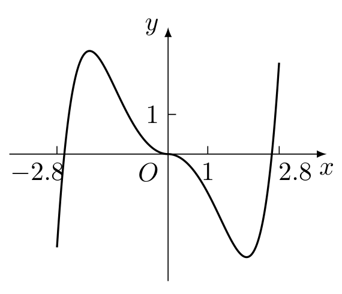
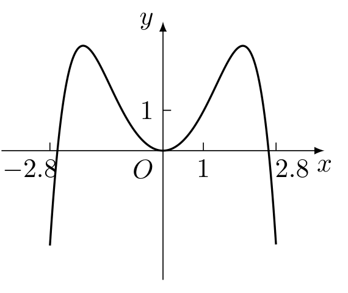
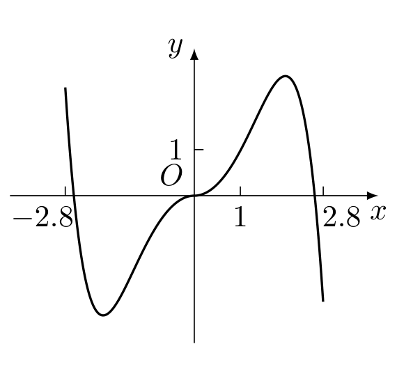
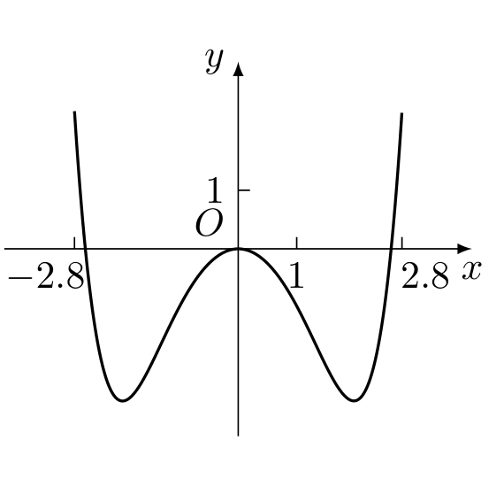
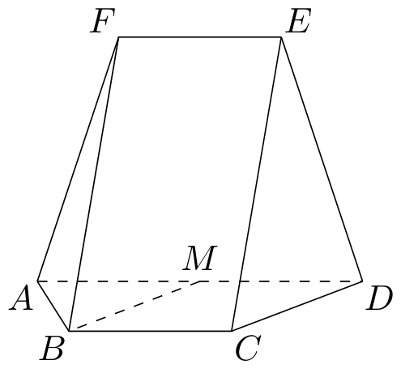

# 2024年全国甲卷（文）

<ClientOnly>
  <ExamViewer paperYear="2024" paperSlug="national_paper_a_liberal" />
</ClientOnly>

::: tip 试卷速览与下载
- **考试年份**：2024 年全国统一高考
- **试卷名称**：2024年全国甲卷（文）
- **下载入口**：[📥 下载高清打印版 PDF](/gaokaomath-typst-page/papers/2024/national_paper_a_liberal.pdf)
:::

## 单选题

### 第 1 题

若 $z=\sqrt{2}\mathrm{i}$，则 $z\bar z=$（ ）

* **A.** $-2$
* **B.** $-\sqrt{2}$
* **C.** $\sqrt{2}$
* **D.** $2$

::: details 💡 点击展开【参考答案与详细解析】

**【参考答案】**：`D`

**【详细解析】**：

由共轭复数的定义，$\bar z=-\sqrt2\mathrm{i}$，所以

$$
z\bar z=(\sqrt2\mathrm{i})(-\sqrt2\mathrm{i})=-2\mathrm{i}^2=2
$$

故选 D.

:::

---

### 第 2 题

已知集合 $A=\{1,2,3,4,5,9\}$，$B=\{x\mid x+1\in A\}$，则 $A\cap B=$（ ）

* **A.** $\{1,2,3\}$
* **B.** $\{3,4,9\}$
* **C.** $\{1,2,3,4\}$
* **D.** $\{2,3,4,5\}$

::: details 💡 点击展开【参考答案与详细解析】

**【参考答案】**：`C`

**【详细解析】**：

由 $x+1\in A$，得

$$
B=\{0,1,2,3,4,8\}
$$

因此

$$
A\cap B=\{1,2,3,4\}
$$

故选 C.

:::

---

### 第 3 题

设向量 $\mathbf{a}=(x+1,x)$，$\mathbf{b}=(x,2)$，$\mathbf{c}=(1,1)$，若 $\mathbf{a}-2\mathbf{b}$ 与 $\mathbf{c}$ 共线，则 $x=$（ ）

* **A.** $\dfrac52$
* **B.** $\dfrac12$
* **C.** $-\dfrac12$
* **D.** $-\dfrac52$

::: details 💡 点击展开【参考答案与详细解析】

**【参考答案】**：`A`

**【详细解析】**：

由题意，$\mathbf{a}-2\mathbf{b}=(1-x,x-4)$. 因为 $\mathbf{a}-2\mathbf{b}$ 与 $\mathbf{c}=(1,1)$ 共线，所以

$$
(1-x)\cdot 1-(x-4)\cdot 1=0
$$

解得 $5-2x=0$，即 $x=\dfrac52$. 故选 A.

:::

---

### 第 4 题

某独唱比赛的决赛阶段共有甲，乙，丙，丁四人参加，每人出场一次，出场次序由随机抽签确定. 则丙不是第一个出场，且甲或乙最后出场的概率是（ ）

* **A.** $\dfrac16$
* **B.** $\dfrac14$
* **C.** $\dfrac13$
* **D.** $\dfrac12$

::: details 💡 点击展开【参考答案与详细解析】

**【参考答案】**：`C`

**【详细解析】**：

总的出场次序有 $4!=24$ 种. 先确定最后出场的是甲或乙，有 $2$ 种选择. 对于其中一种选择，剩下的三人有 $3!$ 种次序，其中丙第一个出场的有 $2!$ 种，所以丙不是第一个出场的有 $3!-2!=4$ 种. 因而满足条件的次序有 $2\times4=8$ 种，所求概率为

$$
\frac{8}{24}=\frac13
$$

故选 C.

:::

---

### 第 5 题

记 $S_n$ 为等差数列 $\{a_n\}$ 的前 $n$ 项和. 已知 $S_9=1$，则 $a_3+a_7=$（ ）

* **A.** $\dfrac19$
* **B.** $\dfrac29$
* **C.** $\dfrac13$
* **D.** $\dfrac23$

::: details 💡 点击展开【参考答案与详细解析】

**【参考答案】**：`B`

**【详细解析】**：

设等差数列的首项为 $a_1$，公差为 $d$. 由等差数列前 $9$ 项和公式，

$$
S_9=\frac{9(a_1+a_9)}2=1
$$

所以 $a_1+a_9=\dfrac29$. 又

$$
a_3+a_7=(a_1+2d)+(a_1+6d)=a_1+a_9=\frac29
$$

故选 B.

:::

---

### 第 6 题

已知双曲线的两个焦点分别为 $(0,4)$，$(0,-4)$，点 $(-6,4)$ 在该双曲线上，则该双曲线的离心率为（ ）

* **A.** $4$
* **B.** $3$
* **C.** $2$
* **D.** $\sqrt2$

::: details 💡 点击展开【参考答案与详细解析】

**【参考答案】**：`C`

**【详细解析】**：

设双曲线的两个焦点为 $F_1=(0,4)$，$F_2=(0,-4)$，则焦距参数 $c=4$. 对点 $P=(-6,4)$，有
$PF_1=6$，$PF_2=\sqrt{(-6)^2+8^2}=10$.
双曲线上一点到两焦点距离之差的绝对值等于 $2a$，因此

$$
2a=|PF_2-PF_1|=4
$$

即 $a=2$. 所以双曲线的离心率为

$$
e=\frac ca=\frac42=2
$$

故选 C.

:::

---

### 第 7 题

设函数 $f(x)=\dfrac{\mathrm{e}^x+2\sin x}{1+x^2}$，则曲线 $y=f(x)$ 在点 $(0,1)$ 处的切线与两坐标轴所围成的三角形的面积为（ ）

* **A.** $\dfrac16$
* **B.** $\dfrac13$
* **C.** $\dfrac12$
* **D.** $\dfrac23$

::: details 💡 点击展开【参考答案与详细解析】

**【参考答案】**：`A`

**【详细解析】**：

由商的求导法则，

$$
f'(0)=\frac{(\mathrm{e}^0+2\cos 0)(1+0^2)-(\mathrm{e}^0+2\sin 0)\cdot 2\cdot 0}{(1+0^2)^2}=3
$$

又 $f(0)=1$，所以曲线在 $(0,1)$ 处的切线方程为 $y=3x+1$. 该直线在 $x$ 轴、$y$ 轴上的截距分别为 $-\dfrac13$、$1$，故所围三角形的面积为

$$
\frac12\times\frac13\times1=\frac16
$$

故选 A.

:::

---

### 第 8 题

函数 $y=-x^2+(\mathrm{e}^x-\mathrm{e}^{-x})\sin x$ 在区间 $[-2.8,2.8]$ 的图象大致为（ ）

* **A.** 

* **B.** 

* **C.** 

* **D.** 

::: details 💡 点击展开【参考答案与详细解析】

**【参考答案】**：`B`

**【详细解析】**：

记 $g(x)=-x^2+(\mathrm{e}^x-\mathrm{e}^{-x})\sin x$. 因为 $\mathrm{e}^x-\mathrm{e}^{-x}$ 与 $\sin x$ 都是奇函数，所以 $g(x)$ 是偶函数，图象关于 $y$ 轴对称. 又 $g(0)=0$，并且

$$
g''(0)=-2+2\bigl(\mathrm{e}^0+\mathrm{e}^0\bigr)\cos0=2>0
$$

所以原点是局部极小点，函数在原点附近为正. 另一方面，直接计算得

$$
g(2.8)=-2.8^2+(\mathrm{e}^{2.8}-\mathrm{e}^{-2.8})\sin2.8
\approx-7.84+16.4\times0.335<0
$$

因此图象关于 $y$ 轴对称，在原点附近向上，在区间两端位于 $x$ 轴下方. 与选项图象对照，故选 B.

:::

---

### 第 9 题

直线 $2x-y-2=0$ 与圆 $x^2+y^2-6x-8y=0$ 交于 $A$，$B$ 两点，则 $|AB|=$（ ）

* **A.** $4$
* **B.** $5$
* **C.** $8$
* **D.** $10$

::: details 💡 点击展开【参考答案与详细解析】

**【参考答案】**：`D`

**【详细解析】**：

圆的方程可化为

$$
(x-3)^2+(y-4)^2=25
$$

所以圆心为 $O_0=(3,4)$，半径为 $5$. 直线 $2x-y-2=0$ 到圆心的距离为

$$
\frac{|2\times3-4-2|}{\sqrt{2^2+(-1)^2}}=0
$$

即直线经过圆心，因此弦 $AB$ 是圆的直径，$|AB|=2\times5=10$. 故选 D.

:::

---

### 第 10 题

已知 $\dfrac{\cos\alpha}{\cos\alpha-\sin\alpha}=\sqrt3$，则 $\tan\left(\alpha+\dfrac\pi4\right)=$（ ）

* **A.** $2\sqrt3+1$
* **B.** $2\sqrt3-1$
* **C.** $\dfrac{\sqrt3}{2}$
* **D.** $1-\sqrt3$

::: details 💡 点击展开【参考答案与详细解析】

**【参考答案】**：`B`

**【详细解析】**：

若 $\cos\alpha=0$，则原式左端为 $0$，不满足题设，所以 $\cos\alpha\ne0$. 令 $t=\tan\alpha$，则

$$
\frac1{1-t}=\sqrt3
$$

从而 $1-t=\dfrac1{\sqrt3}$. 因此

$$
\tan\left(\alpha+\frac\pi4\right)=\frac{t+1}{1-t}
=\frac{2-\frac1{\sqrt3}}{\frac1{\sqrt3}}
=2\sqrt3-1
$$

故选 B.

:::

---

### 第 11 题

设 $\alpha$，$\beta$ 为两个平面，$m$，$n$ 为两条直线，且 $\alpha\cap\beta=m$. 下述四个命题：
\begin{circlelist}
\item 若 $m\parallel n$，则 $n\parallel\alpha$ 或 $n\parallel\beta$；
\item 若 $m\perp n$，则 $n\perp\alpha$ 或 $n\perp\beta$；
\item 若 $n\parallel\alpha$ 且 $n\parallel\beta$，则 $m\parallel n$；
\item 若 $n$ 与 $\alpha$，$\beta$ 所成的角相等，则 $m\perp n$.
\end{circlelist}
其中所有真命题的编号是（ ）

* **A.** $\circled{1}\circled{3}$
* **B.** $\circled{2}\circled{4}$
* **C.** $\circled{1}\circled{2}\circled{3}$
* **D.** $\circled{1}\circled{3}\circled{4}$

::: details 💡 点击展开【参考答案与详细解析】

**【参考答案】**：`A`

**【详细解析】**：

若 $m\parallel n$，由于 $m$ 是平面 $\alpha$，$\beta$ 的交线，直线 $n$ 若不在某个平面内，就与该平面平行；若 $n$ 在其中一个平面内，则因 $n\parallel m$ 且两平面的交线为 $m$，它必与另一个平面平行，所以命题 $\circled{1}$ 正确.

命题 $\circled{2}$ 不正确. 例如取 $\alpha:z=0$，$\beta:y+z=0$，则 $m$ 为 $x$ 轴；取 $n$ 为 $y$ 轴，则 $m\perp n$，但 $n\subset\alpha$，且 $n$ 的方向向量 $(0,1,0)$ 不与平面 $\beta$ 的法向量 $(0,1,1)$ 平行，所以 $n\not\perp\alpha$ 且 $n\not\perp\beta$.

若 $n\parallel\alpha$ 且 $n\parallel\beta$，则 $n$ 的方向同时属于两个平面的方向，因此属于两平面交线 $m$ 的方向，命题 $\circled{3}$ 正确.

命题 $\circled{4}$ 不正确. 例如取 $\alpha:z=0$，$\beta:y=0$，则 $m$ 为 $x$ 轴. 方向向量为 $(1,1,1)$ 的直线与两个平面所成的角相等，但它与 $m$ 不垂直.

所以真命题的编号为 $\circled{1}\circled{3}$，故选 A.

:::

---

### 第 12 题

记 $\triangle ABC$ 的内角 $A$，$B$，$C$ 的对边分别为 $a$，$b$，$c$，已知 $B=60^\circ$，$b^2=\dfrac94ac$，则 $\sin A+\sin C=$（ ）

* **A.** $\dfrac32$
* **B.** $\sqrt2$
* **C.** $\dfrac{\sqrt7}{2}$
* **D.** $\dfrac{\sqrt3}{2}$

::: details 💡 点击展开【参考答案与详细解析】

**【参考答案】**：`C`

**【详细解析】**：

由余弦定理及 $B=60^\circ$，得

$$
b^2=a^2+c^2-2ac\cos60^\circ=a^2+c^2-ac
$$

结合题设 $b^2=\dfrac94ac$，可得

$$
a^2+c^2=\frac{13}{4}ac
$$

于是

$$
(a+c)^2=a^2+c^2+2ac=\frac{21}{4}ac
$$

由正弦定理，

$$
\sin A+\sin C=\frac{a+c}{2R}
=\frac{(a+c)\sin B}{b}
=\frac{\sqrt3(a+c)}{2b}
$$

又 $b^2=\dfrac94ac$，所以

$$
\frac{a+c}{b}=\sqrt{\frac{21}{9}}=\frac{\sqrt{21}}3
$$

因此

$$
\sin A+\sin C=\frac{\sqrt3}{2}\cdot\frac{\sqrt{21}}3=\frac{\sqrt7}{2}
$$

故选 C.

:::

---

## 填空题

### 第 13 题

函数 $f(x)=\sin x-\sqrt3\cos x$ 在区间 $[0,\pi]$ 的最大值为 _______ {}.

::: details 💡 点击展开【参考答案与详细解析】

**【参考答案】**：`2`

**【详细解析】**：

由辅助角公式，

$$
f(x)=\sin x-\sqrt3\cos x=2\sin\left(x-\frac\pi3\right)
$$

当 $x=\dfrac{5\pi}{6}\in[0,\pi]$ 时，$x-\dfrac\pi3=\dfrac\pi2$，函数取得最大值 $2$. 因此填 $2$.

:::

---

### 第 14 题

已知圆台甲，乙的上底面半径均为 $r_1$，下底面半径均为 $r_2$，圆台甲，乙的母线长分别为 $2(r_2-r_1)$，$3(r_2-r_1)$，则圆台甲与乙的体积之比为 _______ {}.

::: details 💡 点击展开【参考答案与详细解析】

**【参考答案】**：`\(\dfrac{\sqrt6}{4}\)`

**【详细解析】**：

记 $d=r_2-r_1>0$. 圆台的母线、高和两底面半径构成直角三角形，所以甲、乙的高分别为

$$
h_{\text{甲}}=\sqrt{[2d]^2-d^2}=\sqrt3d
$$

乙的高为

$$
h_{\text{乙}}=\sqrt{[3d]^2-d^2}=2\sqrt2d
$$

圆台体积公式为 $V=\dfrac13\pi h(r_1^2+r_1r_2+r_2^2)$. 两个圆台的上下底面半径相同，因此

$$
\frac{V_{\text{甲}}}{V_{\text{乙}}}=\frac{h_{\text{甲}}}{h_{\text{乙}}}=\frac{\sqrt3d}{2\sqrt2d}=\frac{\sqrt6}{4}
$$

所以圆台甲与乙的体积之比为 $\dfrac{\sqrt6}{4}$.

:::

---

### 第 15 题

已知 $a>1$ 且 $\dfrac1{\log_8a}-\dfrac1{\log_a4}=-\dfrac52$，则 $a=$ _______ {}.

::: details 💡 点击展开【参考答案与详细解析】

**【参考答案】**：`64`

**【详细解析】**：

由换底公式，
$\frac1{\log_8a}=\log_a8$，$\frac1{\log_a4}=\log_4a$.
令 $t=\log_2a$. 由 $a>1$ 知 $t>0$，且
$\log_a8=\frac3t$，$\log_4a=\frac t2$.
代入题设，得

$$
\frac3t-\frac t2=-\frac52
$$

两边乘以 $2t$，得

$$
6-t^2=-5t
$$

即 $t^2-5t-6=0$. 所以 $t=6$ 或 $t=-1$，结合 $t>0$ 得 $t=6$. 因而

$$
a=2^t=2^6=64
$$

因此填 $64$.

:::

---

### 第 16 题

当 $x>0$ 时，曲线 $y=x^3-3x$ 与曲线 $y=-(x-1)^2+a$ 有两个交点，则 $a$ 的取值范围是 _______ {}.

::: details 💡 点击展开【参考答案与详细解析】

**【参考答案】**：`\((-2,1)\)`

**【详细解析】**：

两曲线相交时，

$$
x^3-3x=-(x-1)^2+a
$$

所以

$$
a=g(x):=x^3+x^2-5x+1
$$

在 $x>0$ 上，

$$
g'(x)=3x^2+2x-5=(3x+5)(x-1)
$$

因此 $g(x)$ 在 $(0,1)$ 上单调递减，在 $(1,+\infty)$ 上单调递增，且
$\lim_{x\to0^+}g(x)=1$，$g(1)=-2$，$\lim_{x\to+\infty}g(x)=+\infty$.
当 $-2<a<1$ 时，方程 $g(x)=a$ 在 $(0,1)$ 和 $(1,+\infty)$ 各有一个根，即两曲线有两个交点. 当 $a=-2$ 或 $a=1$ 时只有一个正根，其他情形也不可能有两个正根. 所以

$$
a\in(-2,1)
$$

因此填 $(-2,1)$.

:::

---

## 解答题

### 第 17 题

记 $S_n$ 为等比数列 $\{a_n\}$ 的前 $n$ 项和，已知 $2S_n=3a_{n+1}-3$.

(1) 求 $\{a_n\}$ 的通项公式；

(2) 求数列 $\{S_n\}$ 的前 $n$ 项和.

::: details 💡 点击展开【参考答案与详细解析】

**【详细解析】**：

(1) 对 $n\ge2$，在已知等式中分别取 $n$ 和 $n-1$，相减得

$$
2a_n=3a_{n+1}-3a_n
$$

所以 $3a_{n+1}=5a_n$，即等比数列的公比为 $q=\dfrac53$. 取 $n=1$，由 $2a_1=3a_2-3$ 得 $2a_1=5a_1-3$，从而 $a_1=1$. 因此

$$
a_n=a_1q^{n-1}=\left(\dfrac53\right)^{n-1}
$$

(2) 因为 $q\ne1$，所以

$$
S_n=a_1\frac{q^n-1}{q-1}=\frac{(\frac{5}{3})^n-1}{\frac{2}{3}}=\frac32\left(\dfrac53\right)^n-\frac32
$$

设数列 $\{S_n\}$ 的前 $n$ 项和为 $T_n$，则

$$
T_n=\sum_{k=1}^nS_k=\frac32\sum_{k=1}^n\left[\left(\dfrac53\right)^k-1\right]
=\frac32\left[\frac{\frac53\left[\left(\dfrac53\right)^n-1\right]}{\frac53-1}-n\right]
=\frac{15}{4}\left(\dfrac53\right)^n-\frac{15}{4}-\frac32n
$$

:::

---

### 第 18 题

某工厂进行生产线智能化升级改造. 升级改造后，从该工厂甲，乙两个车间的产品中随机抽取 $150\text{ 件}$ 进行检验，数据如下：
\begin{center}
\begin{tabular}{c|ccc|c}
 & 优级品 & 合格品 & 不合格品 & 总计\\ \hline
甲车间 & 26 & 24 & 0 & 50\\
乙车间 & 70 & 28 & 2 & 100\\ \hline
总计 & 96 & 52 & 2 & 150
\end{tabular}
\end{center}

(1) 填写如下列联表：
\begin{center}
\begin{tabular}{c|cc}
 & 优级品 & 非优级品\\ \hline
甲车间 & _______ {} & _______ {} \\
乙车间 & _______ {} & _______ {} \\
\end{tabular}
\end{center}
能否有 $95\%$ 的把握认为甲，乙两车间产品的优级品率存在差异？能否有 $99\%$ 的把握认为甲，乙两车间产品的优级品率存在差异？

(2) 已知升级改造前该工厂产品的优级品率 $p=0.5$. 设 $\bar p$ 为升级改造后抽取的 $n\text{ 件}$ 产品的优级品率，如果 $\bar p>p+1.65\sqrt{\dfrac{p(1-p)}n}$，则认为该工厂产品的优级品率提高了. 根据抽取的 $150\text{ 件}$ 产品的数据，能否认为生产线智能化升级改造后，该工厂产品的优级品率提高了？（$\sqrt{150}\approx12.247$）

附：$K^2=\dfrac{n(ad-bc)^2}{(a+b)(c+d)(a+c)(b+d)}$，$P(K^2\ge k)$ 的临界值如下：
\begin{center}
\begin{tabular}{c|ccc}
 & 0.050 & 0.010 & 0.001\\ \hline
$k$ & 3.841 & 6.635 & 10.828
\end{tabular}
\end{center}

::: details 💡 点击展开【参考答案与详细解析】

**【详细解析】**：

(1) 列联表为
\begin{center}
\begin{tabular}{c|cc}
 & \text{优级品} & \text{非优级品}\\ \hline
\text{甲车间} & 26 & 24\\
\text{乙车间} & 70 & 30
\end{tabular}
\end{center}
令甲车间优级品、非优级品的数量分别为 $a=26$、$b=24$，乙车间对应数量分别为 $c=70$、$d=30$. 则

$$
K^2=\frac{150(26\times30-24\times70)^2}{50\times100\times96\times54}=4.6875
$$

因为 $4.6875>3.841$ 且 $4.6875<6.635$，所以有 $95\%$ 的把握认为两车间产品的优级品率存在差异，但没有 $99\%$ 的把握认为两车间产品的优级品率存在差异.

(2) 由样本数据，升级改造后产品的优级品率为

$$
\bar p=\frac{96}{150}=0.64
$$

又由题设可得

$$
p+1.65\sqrt{\frac{p(1-p)}{n}}=0.5+1.65\sqrt{\frac{0.5\times0.5}{150}}=0.5+\frac{0.825}{\sqrt{150}}\approx0.567
$$

因为 $0.64>0.567$，所以能认为升级改造后该工厂产品的优级品率提高了.

:::

---

### 第 19 题

如图，在以 $A$，$B$，$C$，$D$，$E$，$F$ 为顶点的五面体中，四边形 $ABCD$ 与四边形 $ADEF$ 均为等腰梯形，$EF\parallel AD$，$BC\parallel AD$，$AD=4$，$AB=BC=EF=2$，$ED=\sqrt{10}$，$FB=2\sqrt3$，$M$ 为 $AD$ 的中点.

(1) 证明：$BM\parallel$ 平面 $CDE$；

(2) 求 $M$ 到平面 $FAB$ 的距离.

::: details 💡 点击展开【参考答案与详细解析】

**【详细解析】**：

取 $AD$ 所在直线为 $x$ 轴，并利用两个等腰梯形的对称性建立直角坐标系. 由 $AD=4$、$BC=2$、$AB=2$，梯形 $ABCD$ 中每条腰在垂直于 $AD$ 方向的分量为 $\sqrt{2^2-1^2}=\sqrt3$. 由 $AD=4$、$EF=2$、$ED=\sqrt{10}$，梯形 $ADEF$ 中每条腰在垂直于 $AD$ 方向的分量为 $\sqrt{(\sqrt{10})^2-1^2}=3$.

设两个梯形所在平面内垂直于 $AD$ 的单位方向向量分别为 $\mathbf{u}$、$\mathbf{v}$. 由对称性，$B$ 和 $F$ 在 $AD$ 方向上的坐标相同，且

$$
\overrightarrow{BF}=3\mathbf{v}-\sqrt3\mathbf{u}
$$

由 $FB=2\sqrt3$ 得

$$
12=FB^2=\left|3\mathbf{v}-\sqrt3\mathbf{u}\right|^2=12-6\sqrt3\,\mathbf{u}\cdot\mathbf{v}
$$

所以 $\mathbf{u}\cdot\mathbf{v}=0$. 因而可取
$A=(0,0,0)$，$D=(4,0,0)$，$B=(1,0,\sqrt3)$，$C=(3,0,\sqrt3)$，$F=(1,3,0)$，$E=(3,3,0)$，$M=(2,0,0)$.

(1) $\overrightarrow{BM}=(1,0,-\sqrt3)=\overrightarrow{CD}$，而直线 $CD$ 在平面 $CDE$ 内. 另外，由 $C$，$D$，$E$ 的坐标可得平面 $CDE$ 的方程为

$$
3x+y+\sqrt3z=12
$$

代入 $M=(2,0,0)$ 得左端为 $6$，所以 $M\notin$ 平面 $CDE$. 因此 $BM\parallel CD$，且 $BM$ 不在平面 $CDE$ 内，从而 $BM\parallel$ 平面 $CDE$.

(2) 平面 $FAB$ 经过原点 $A$，且

$$
\overrightarrow{AF}=(1,3,0)
$$

且 $\overrightarrow{AB}=(1,0,\sqrt3)$.
其法向量可取

$$
\overrightarrow{AF}\times\overrightarrow{AB}=(3\sqrt3,-\sqrt3,-3)
$$

所以平面 $FAB$ 的方程为

$$
3x-y-\sqrt3z=0
$$

点 $M$ 到该平面的距离为

$$
\frac{|3\times2-0-\sqrt3\times0|}{\sqrt{3^2+(-1)^2+(-\sqrt3)^2}}=\frac6{\sqrt{13}}=\frac{6\sqrt{13}}{13}
$$

:::

---

### 第 20 题

已知函数 $f(x)=a(x-1)-\ln x+1$.

(1) 讨论 $f(x)$ 的单调性；

(2) 设 $a\le2$，证明：当 $x>1$ 时，$f(x)<\mathrm{e}^{x-1}$.

::: details 💡 点击展开【参考答案与详细解析】

**【详细解析】**：

因为函数的定义域为 $(0,+\infty)$，且

$$
f'(x)=a-\frac1x=\frac{ax-1}{x}
$$

(1) 当 $a\le0$ 时，对任意 $x>0$ 都有 $ax-1<0$，所以 $f(x)$ 在 $(0,+\infty)$ 上单调递减.

当 $a>0$ 时，$f'(x)<0$ 适用于 $0<x<\dfrac1a$，$f'(x)=0$ 在 $x=\dfrac1a$ 处成立，$f'(x)>0$ 适用于 $x>\dfrac1a$. 因此 $f(x)$ 在 $\left(0,\dfrac1a\right)$ 上单调递减，在 $\left(\dfrac1a,+\infty\right)$ 上单调递增.

(2) 令 $t=x-1>0$，并定义

$$
h(t)=\mathrm{e}^t-\left(2t-\ln(1+t)+1\right)
$$

因为 $a\le2$，所以

$$
f(x)=at-\ln(1+t)+1\le2t-\ln(1+t)+1
$$

又 $h(0)=0$，且
$h'(t)=\mathrm{e}^t-2+\frac1{1+t}$，$h''(t)=\mathrm{e}^t-\frac1{(1+t)^2}$.
当 $t>0$ 时，$\mathrm{e}^t>1>\dfrac1{(1+t)^2}$，所以 $h''(t)>0$. 因此 $h'(t)>h'(0)=0$，进而 $h(t)>h(0)=0$. 于是

$$
2t-\ln(1+t)+1<\mathrm{e}^t
$$

结合前面的不等式，得到 $f(x)<\mathrm{e}^{x-1}$.

:::

---

### 第 21 题

设椭圆 $C:\dfrac{x^2}{a^2}+\dfrac{y^2}{b^2}=1$（$a>b>0$） 的右焦点为 $F$，点 $M\left(1,\dfrac32\right)$ 在 $C$ 上，且 $MF\perp x$ 轴.

(1) 求 $C$ 的方程；

(2) 过点 $P(4,0)$ 的直线交 $C$ 于 $A$，$B$ 两点，$N$ 为线段 $FP$ 的中点，直线 $NB$ 交直线 $MF$ 于点 $Q$，证明：$AQ\perp y$ 轴.

::: details 💡 点击展开【参考答案与详细解析】

**【详细解析】**：

(1) 设右焦点为 $F=(c,0)$. 因为 $MF\perp x$ 轴，且 $M$ 的横坐标为 $1$，所以 $c=1$. 由焦点关系 $c^2=a^2-b^2$，得

$$
a^2-b^2=1
$$

又因为 $M\left(1,\dfrac32\right)$ 在椭圆上，所以

$$
\frac1{a^2}+\frac9{4b^2}=1
$$

令 $A=a^2$，$B=b^2$，则 $A=B+1$，从而

$$
\frac1{B+1}+\frac9{4B}=1
$$

整理得 $4B^2-9B-9=0$，解得 $B=3$ 或 $B=-\dfrac34$. 因为 $B=b^2>0$，所以 $b^2=3$，进而 $a^2=4$. 因此

$$
C:\frac{x^2}{4}+\frac{y^2}{3}=1
$$

(2) 由第（1）问，$F=(1,0)$，故 $N=\left(\dfrac52,0\right)$. 过 $P=(4,0)$ 的竖直直线为 $x=4$，不与椭圆相交，因此设过 $P$ 的交椭圆直线斜率为 $k$，则其方程为 $y=k(x-4)$. 直线与椭圆交于 $A(x_1,y_1)$、$B(x_2,y_2)$，代入椭圆方程得

$$
(3+4k^2)x^2-32k^2x+64k^2-12=0
$$

因此由韦达定理
$x_1+x_2=\frac{32k^2}{3+4k^2}$，$x_1x_2=\frac{64k^2-12}{3+4k^2}$.
于是

$$
2x_1x_2-5(x_1+x_2)+8=0
$$

直线 $MF$ 的方程为 $x=1$. 由 $N\left(\dfrac52,0\right)$ 和 $B\left(x_2,k(x_2-4)\right)$，直线 $NB$ 与 $x=1$ 的交点 $Q$ 的纵坐标为

$$
y_Q=-\frac32\frac{k(x_2-4)}{x_2-\frac52}=-\frac{3k(x_2-4)}{2x_2-5}
$$

由前面的关系

$$
(x_1-4)(2x_2-5)+3(x_2-4)=2x_1x_2-5(x_1+x_2)+8=0
$$

所以

$$
y_Q=k(x_1-4)=y_A
$$

因此 $AQ$ 为水平直线，从而 $AQ\perp y$ 轴.

:::

---

## 选考题：解答题

### 第 22 题

在平面直角坐标系 $xOy$ 中，以坐标原点 $O$ 为极点，$x$ 轴正半轴为极轴建立极坐标系，曲线 $C$ 的极坐标方程为 $\rho=\rho\cos\theta+1$.

(1) 写出 $C$ 的直角坐标方程；

(2) 设直线 $l$ 的参数方程为 $\begin{cases}
x=t,\\
y=t+a
\end{cases}\ (t\text{ 为参数})$，若 $C$ 与 $l$ 相交于 $A$，$B$ 两点，且 $|AB|=2$，求 $a$.

::: details 💡 点击展开【参考答案与详细解析】

**【详细解析】**：

(1) 由极坐标与直角坐标的关系 $x=\rho\cos\theta$、$y=\rho\sin\theta$、$\rho^2=x^2+y^2$，原方程化为 $\rho=x+1$. 两边平方得

$$
x^2+y^2=(x+1)^2
$$

所以 $C$ 的直角坐标方程为 $y^2=2x+1$.

(2) 将直线的参数方程代入上式，得

$$
(t+a)^2=2t+1
$$

即有

$$
t^2+2(a-1)t+a^2-1=0
$$

设两交点对应的参数为 $t_1$，$t_2$. 因为两点的坐标差为 $(t_1-t_2,t_1-t_2)$，所以

$$
|AB|=\sqrt2|t_1-t_2|=2
$$

该一元二次方程的判别式为

$$
\Delta=4(a-1)^2-4(a^2-1)=8(1-a)
$$

又 $|t_1-t_2|=\sqrt\Delta$，故

$$
\sqrt2\sqrt{8(1-a)}=2
$$

解得 $1-a=\dfrac14$，所以 $a=\dfrac34$.

:::

---

### 第 23 题

已知实数 $a$，$b$ 满足 $a+b\ge3$.

(1) 证明：$2a^2+2b^2>a+b$；

(2) 证明：$|a-2b^2|+|b-2a^2|\ge6$.

::: details 💡 点击展开【参考答案与详细解析】

**【详细解析】**：

(1) 由基本不等式，

$$
2a^2+2b^2\ge(a+b)^2
$$

令 $s=a+b$，则 $s\ge3$，从而 $s^2>s$. 因此

$$
2a^2+2b^2\ge(a+b)^2>a+b
$$

(2) 由三角不等式，

$$
|a-2b^2|+|b-2a^2|\ge\left|a+b-2a^2-2b^2\right|
$$

由第（1）问知 $2a^2+2b^2>a+b$，所以

$$
\left|a+b-2a^2-2b^2\right|=2a^2+2b^2-a-b
$$

再次利用 $2a^2+2b^2\ge(a+b)^2$，得到

$$
|a-2b^2|+|b-2a^2|\ge(a+b)^2-(a+b)=s(s-1)
$$

因为 $s\ge3$，所以 $s(s-1)\ge3\times2=6$. 故

$$
|a-2b^2|+|b-2a^2|\ge6
$$

:::

---

