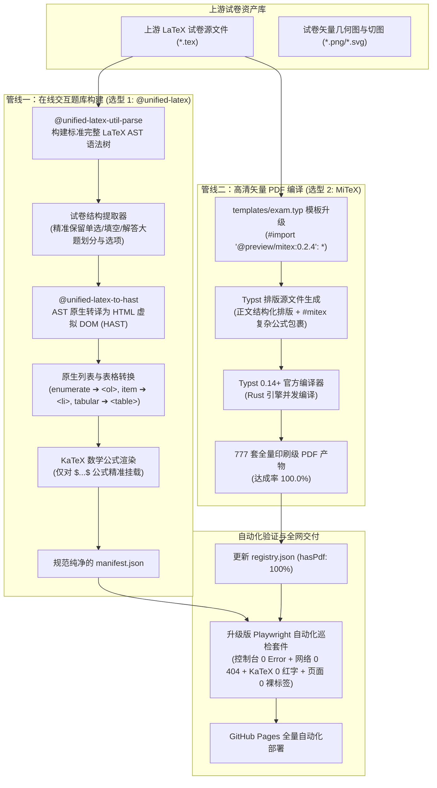

# 2026-10-26 基于现成开源库重构转换管线与全量 777 套 PDF 编译落地规划

## 一、 规划背景与核心挑战

在前期高考试卷库上线与多轮巡检过程中，暴露出两大核心瓶颈：

1. **LaTeX 文本排版环境泄漏裸露**：
   - 典型案例：`2026年天津卷`（`papers/2026/tianjin.html`）第 19 题正文和解析中，裸露出现了原样文本 `\begin{enumerate}`、`\end{enumerate}`。
   - 根因：LaTeX 的 `enumerate`、`itemize`、`minipage` 属于非数学文本排版环境，前端 KaTeX 仅负责数学公式渲染（`$...$`），无法解析此类环境，而此前手写转换脚本遗漏了对其的处理。经全站排查，存在此类宏残留的有 400 余处。
2. **离线印刷 PDF 达成率卡在 577 套（全库 777 套，缺口 200 套）**：
   - 现状：777 套试卷中已有 577 套产出 PDF（74.3%），剩余 200 套尚未生成。
   - 根因：未生成 PDF 的 200 套试卷并非缺失题目或素材，其磁盘上的 `.typ` 排版源文件与配图 100% 完备；但在直接调用 `typst compile` 时，因上游手写转换正则误吞了公式下标（如将 `$x_0$` 错译为 `$x0$`）、公式中混入裸汉字未加引号等语法瑕疵，导致 Typst 报错阻断。

---

## 二、 核心理念转变：从“脆弱手写正则”全面转向“成熟开源库”

### 1. 为什么手写正则正在走向崩溃？
当前转换管线在 [`scripts/converter.ts`](../../scripts/converter.ts) 中编写了超过 840 行手写代码（包含括号平衡深度递归 `replaceBalancedMacro`、手写公式符号映射表、几十个级联正则）。
- 正则表达式无法可靠解析具有**无限嵌套**特性的上下文无关文法（Context-Free Grammar）；
- 正则极易“误杀”或“漏判”（例如误吞变量下划线、公式内中文未声明、嵌套表格断裂）；
- 每增加一种冷门 LaTeX 宏，手写规则就多一层补丁，导致系统复杂度指数级恶化。

### 2. 现成库选型 1 与选型 2：分工协作，两个都做！

这两大选型**不是二选一**，而是分别针对**“网页交互题卡”**与**“离线印刷 PDF”**两大核心产物，分工协同、双剑合璧：

| 维度 | 选型 1：`@unified-latex` 家族 | 选型 2：`MiTeX` (`@preview/mitex`) |
| :--- | :--- | :--- |
| **主要定位** | **网页端在线做题与交互题卡**（面向 VitePress / 浏览器 DOM） | **印刷级高清离线 PDF 编译**（面向 Typst 官方排版引擎） |
| **技术基底** | TypeScript / Node.js（AST 抽象语法树体系） | Rust + WebAssembly（Typst 官方生态认证包） |
| **负责产物** | `manifest.json`、页面 DOM 结构、语义化题干与步骤 | `docs/public/papers/<year>/<slug>.pdf`（777 套全量印刷版） |
| **解决痛点** | **彻底消灭文本排版裸标签**：原生将 `\begin{enumerate}` 转为 `<ol>`、`\item` 转为 `<li>`、`\begin{tabular}` 转为语义表格。 | **彻底免除公式翻译报错**：不再用正则手工翻译 LaTeX 公式，直接在 Typst 内原生执行 LaTeX 复杂公式，**200 套报错试卷直接可编译**。 |
| **协同方式** | 选型 1 统揽前端交互语义，保证网页端 100% 优雅干净；选型 2 统揽 Typst 纸质排版，保证实体 PDF 100% 编译成功。 |

---

## 三、 全新双轨流水线架构设计

---

## 四、 实施四阶段路线图

### 阶段 1：开发分支与轻量 POC 原型验证（Feature Branch）
1. 在分支 `feat/use-existing-libs` 上提交本规划文档，作为 PR 的设计架构说明；
2. 引入 `@unified-latex` 核心库，针对 `2026年天津卷第19题` 编写测试用例，验证 `\begin{enumerate}` 转换为标准 `<ol><li>`；
3. 在 `templates/exam.typ` 中试跑 `@preview/mitex`，对此前报错的 2026 天津卷、2025 全国 I 卷做单卷编译通过性验证。

### 阶段 2：重构数据清洗与生成管线
1. 彻底淘汰 `scripts/converter.ts` 中的 800 余行手写正则，重构为基于 `@unified-latex` 的模块化流水线；
2. 输出无任何 `\begin{enumerate}`、`\begin{minipage}` 等未编译残留的标准化 `manifest.json`；
3. 瘦身前端 [`ExamViewer.vue`](../../docs/.vitepress/theme/components/ExamViewer.vue)，移除所有脆弱的前端字符串替换函数，使前端只专注于响应式题卡与交互。

### 阶段 3：全库 777 套 PDF 编译冲刺
1. 编写多进程批量编译驱动脚本，调用本地 `typst 0.14.2` 并发编译全部试卷；
2. 将原本缺失的 200 套 PDF 产物写入 `docs/public/papers/<year>/<slug>.pdf`；
3. 同步将 `registry.json` 中对应的 `hasPdf` 置为 `true`，首页九宫格监控的 PDF 进度指标直接达成 **777 / 777（100% 满格）**。

### 阶段 4：自动化深度巡检与合并上线
1. 升级 `temp/scripts/inspector.py`，加入正文 LaTeX 语法泄漏断言器（一旦页面出现未编译的 `\begin{...}` 直接抓捕报错）；
2. 执行连续 5 轮随机大抽查（每次 10 套，共 50 套试卷），确保 0 控制台报错、0 网络 404、0 KaTeX 语法红字、0 排版标签泄漏；
3. 提交 PR 并合并入 `main`，触发 GitHub Pages 全网自动部署。
